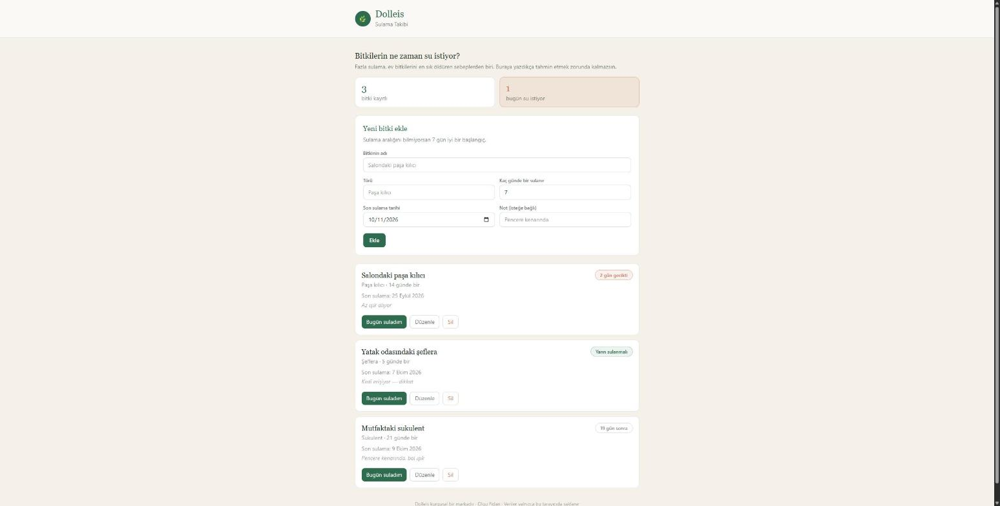

# Dolleis — Sulama Takibi

Ev bitkilerinin ne zaman sulanması gerektiğini takip eden tek sayfalık bir React
uygulaması. Veriler tarayıcının LocalStorage'ında tutulur; sunucu veya veritabanı
gerekmez.

**Canlı demo:** _(Netlify adresi buraya)_



## Neden bu konu

Fazla sulama, ev bitkilerini en sık öldüren sebeplerden biri. Çoğu kişi "ne zaman
sulamalıyım" sorusunu tahminle cevaplıyor. Uygulama bu tahmini ortadan kaldırıyor:
her bitki için sulama aralığını ve son sulama tarihini saklayıp kaç gün kaldığını
hesaplıyor, geciken bitkileri listenin en üstüne taşıyor.

Dolleis, aynı eğitim programının içerik üretimi projesinde kurgulanan markadır;
bu uygulama o markanın görsel diliyle aynı paleti kullanır.

## Kullanılan teknolojiler

| Katman | Seçim |
|---|---|
| Kütüphane | React 19 |
| Derleme aracı | Vite |
| Stil | Tailwind CSS v4 |
| Veri saklama | LocalStorage |
| Yayın | Netlify |

## Dört temel işlem

| İşlem | Nerede |
|---|---|
| **Ekle** | Formdan yeni bitki eklenir — `BitkiFormu.jsx` |
| **Listele** | Kartlar, suyu en acil olan en üstte — `BitkiListesi.jsx` |
| **Güncelle** | "Düzenle" ile tüm alanlar, "Bugün suladım" ile tarih — `AnaSayfa.jsx` |
| **Sil** | Kart içinde onaylı silme — `BitkiKarti.jsx` |

## Klasör yapısı

```
src/
├── components/        Tekrar kullanılan arayüz parçaları
│   ├── Baslik.jsx
│   ├── Ozet.jsx
│   ├── BitkiFormu.jsx     Ekleme ve güncelleme formu
│   ├── BitkiListesi.jsx
│   └── BitkiKarti.jsx
├── pages/
│   └── AnaSayfa.jsx       Durum yönetimi ve LocalStorage
├── interfaces/
│   └── bitki.js           Veri yapısı ve tarih hesapları
├── App.jsx
└── main.jsx
```

## Kurulum

```bash
npm install
npm run dev
```

Derlemek için:

```bash
npm run build
```

## Notlar

- Veriler yalnızca o tarayıcıda saklanır; başka cihaza taşınmaz.
- Tarayıcı depolamayı engellerse uygulama yine çalışır, veriler kalıcı olmaz.
- Dolleis kurgusal bir markadır; proje kapsamında eğitim amacıyla oluşturulmuştur.

## Geliştirici

Olgu Fidan · ixtivh@gmail.com
